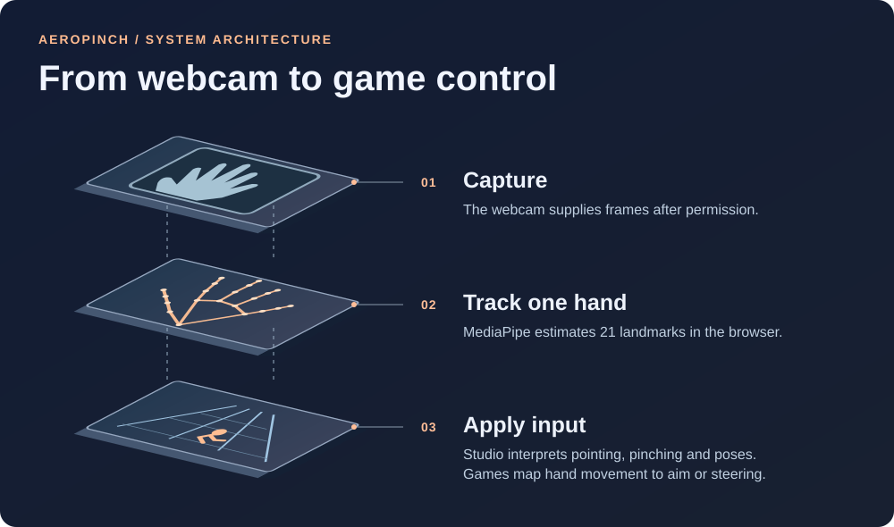

# AeroPinch

A webcam gesture studio and two browser games by **Anmol Rathod**. Point to move a virtual cursor, pinch to pick up an object, or steer a runner by moving your palm from side to side. Camera frames are processed on your device. The virtual cursor controls the AeroPinch page.

**[Launch AeroPinch](https://aeropinch.vercel.app/) · [Open Gesture Studio](https://aeropinch.vercel.app/#studio) · [Play the games](https://aeropinch.vercel.app/#games)**

## Try it

Open **Gesture Studio → Start camera** and allow camera access. Keep one hand in view and point at the playground puck. Pinch your thumb and index finger, move the puck, then release. The camera preview is mirrored so the cursor follows the direction you see on screen.

| Experience | Hand controls | Other controls |
| --- | --- | --- |
| Gesture Studio | Point to move. Briefly pinch thumb and index to click, or hold and move to drag. Pinch thumb and middle finger to open the playground menu. Raise two fingers and move vertically to scroll. An open palm enlarges the puck and a fist shrinks it. | Mouse or touch in the playground |
| Orbit Blaster | Enable the camera and start the game. Point to aim and pinch thumb and index to fire. Hit as many targets as possible in 30 seconds. | Tap a target, or aim with the arrow keys and fire with Space |
| Gale Runner | Select **Play with hand** and hold your hand still to set the center. Move your palm sideways to steer continuously. Pinch thumb and index to jump gates. Steer around crates. If tracking drops, the run pauses until your hand returns. | Select **Use keys or touch**. Steer with ← or → and jump with ↑ or Space. Swipe or use the on-screen buttons on touch devices. |

## How it works



The browser loads the MediaPipe Hand Landmarker and its WebAssembly runtime from the site. Each new video frame produces up to one set of 21 landmarks. The studio smooths the index fingertip with a One Euro filter and measures pinches relative to palm size. Gale Runner averages the wrist and four knuckle positions, calibrates a personal center, and uses sideways displacement to steer. Orbit Blaster uses the index fingertip for aim.

Three.js and Vanta render the cloud intro. The studio has an articulated robotic hand backdrop. Both games render to a 2D canvas, independently of the decorative 3D scene.

## Run locally

Use Node.js 22 LTS, npm, and Python 3 for the local static server. In the repository root, run the following commands.

```sh
npm ci
npm run build
python3 -m http.server 4173 --bind 127.0.0.1 --directory dist
```

Open [localhost:4173](http://localhost:4173). On Windows, use `py -m http.server 4173 --bind 127.0.0.1 --directory dist` if Python is available through the Windows launcher. Rebuild after editing files in `public/`.

The build downloads the versioned hand model, verifies its SHA-256 checksum, and copies the model, runtime, and visual assets into `dist/`. The build machine needs internet access. The deployed application runs on a static host with HTTPS.

## Test

```sh
node --test tests/*.test.mjs
```

The tests feed synthetic hand landmarks into the Gale Runner controller. They cover center calibration, mirrored steering, tracking loss and recovery, pinch-to-jump, and switching to manual steering. To check a webcam on a new device, start a hand-controlled run, steer to both sides, briefly move your hand out of view, then bring it back and pinch to jump.

## Source map

| File | Responsibility |
| --- | --- |
| [app.js](public/app.js) | Camera permission, model loading, inference loop and studio actions |
| [gestures.js](public/gestures.js) | Studio gesture recognition, cursor smoothing and pinch state |
| [arcade.js](public/arcade.js) | Game selection, camera handoff, input routing and pause/resume |
| [runner-hand.js](public/runner-hand.js) | Palm calibration, continuous steering and pinch detection |
| [game-worlds.js](public/game-worlds.js) | Simulation, collisions, scoring and canvas drawing |
| [hand-rig.js](public/hand-rig.js) | Articulated 3D hand geometry and finger motion |
| [build.mjs](build.mjs) | Static build, local runtime assets and model verification |

## Deploy on Vercel

Import the repository as a static project using the **Other** framework preset. The checked-in [Vercel configuration](vercel.json) sets the build command to `npm run build`, publishes `dist/`, and permits same-origin camera use. The app requires no API keys.

## Troubleshooting

- **Camera unavailable.** Open the site directly over HTTPS or localhost, allow camera access for that origin, and close any app occupying the webcam.
- **Runner waits for a hand.** Select **Play with hand**, fit your palm and wrist in the mirrored preview, and hold still briefly. After calibration, move sideways from that starting position.
- **Model fails to load.** Serve the built `dist/` directory and confirm it contains `hand_landmarker.task`, `vision.mjs` and `wasm/`. Rebuild with internet access if an asset is missing.
